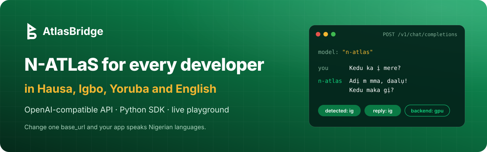
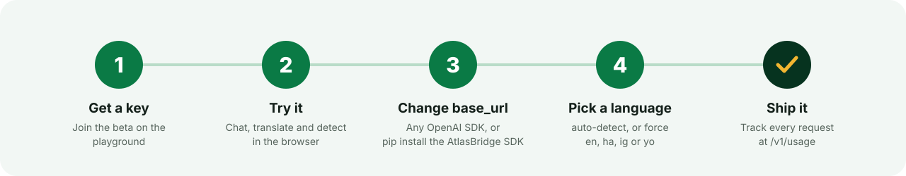
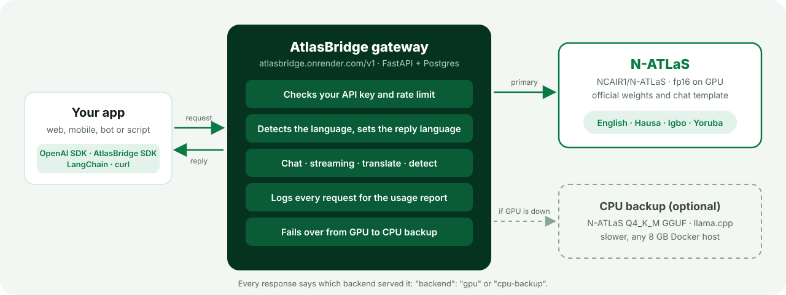
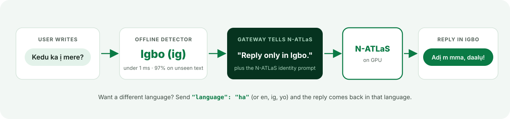

<p align="center">
  
</p>

<p align="center">
  <a href="https://atlasbridge.onrender.com"></a>
  
  
  
  <a href="https://huggingface.co/NCAIR1/N-ATLaS"></a>
  <a href="LICENSE"></a>
  <a href="CONTRIBUTING.md"></a>
</p>

# AtlasBridge

**An OpenAI-compatible developer gateway and Python SDK for N-ATLaS, Nigeria's multilingual LLM (English, Hausa, Igbo, Yoruba).**

N-ATLaS is open, but using it today means downloading an 8B-parameter model, finding a GPU, and wiring up its chat template yourself. Most Nigerian developers can't do that. AtlasBridge hosts N-ATLaS behind the API shape the whole ecosystem already speaks. Any app that uses the OpenAI SDK, LangChain or plain `fetch` can switch to N-ATLaS by changing its `base_url`.

> N-ATLaS is an initiative of the Federal Ministry of Communications, Innovation and Digital Economy, and powered by Awarri Technologies.

Built for the National AI Innovation Challenge 2026, Problem Statement 1 (Developer Infrastructure).

**Current version: v2.2.0** (developer accounts, dashboard and website).

**Live:** https://atlasbridge.onrender.com · **Repo:** https://github.com/Kingsmichaei/atlasbridge · See [CHANGELOG.md](CHANGELOG.md).

<p align="center">
  
</p>

## What's included

| Part | Path | What it does |
|---|---|---|
| Serving notebook | `serving/atlasbridge_serve_kaggle.ipynb` | Runs `NCAIR1/N-ATLaS` on a GPU (Kaggle 2×T4) as an OpenAI-compatible server and exposes it through a secure tunnel |
| CPU backup (optional) | `serving/cpu-backup/` | Docker image running the N-ATLaS Q4_K_M GGUF on llama.cpp. When configured, the gateway fails over to it automatically when the GPU is off |
| Gateway | `gateway/` | FastAPI service: API keys, rate limits, streaming chat, translation, language detection, usage logging and a validation report |
| Python SDK + CLI | `sdk/` | `pip install` client: `chat`, `stream`, `translate`, `detect_language`, multi-turn `Conversation`, `atlasbridge` CLI |
| Website | `web/` | React site served at `/`: landing page, developer sign-up and login, a dashboard for API keys and usage, the playground, and docs at `/guide` |
| Classic playground | `gateway/app/static/index.html` | The original single-page playground, now at `/classic` (and at `/` if the website hasn't been built) |

## Architecture

<p align="center">
  
</p>

**Language handling.** N-ATLaS is an 8B model, and left to itself it sometimes answers in the wrong Nigerian language, especially in conversations that switch languages. The gateway detects the language of each message offline (97% on a held-out set of everyday phrases typed with or without diacritics) and names the reply language in the system prompt. Developers can override it with `language`.

<p align="center">
  
</p>

**How the integration works.** Every model call goes to `NCAIR1/N-ATLaS`, and no other model is used. The serving layer loads the official weights and applies N-ATLaS's own chat template (including its `date_string` system header). It uses the generation settings recommended on the model card: temperature 0.1 and repetition penalty 1.12. The gateway adds a default multilingual system prompt and builds translation and language-ID tasks as N-ATLaS prompts.

## Website and developer dashboard

The website at https://atlasbridge.onrender.com is the easiest way in:

- **Sign up** at `/signup` with the beta invite code, and you're logged in to the **dashboard**.
- **API keys** (`/dashboard/keys`): create up to 5 active keys with labels such as "Production" or "Test". A new key is shown once, with a copy button. Rotate a key (the old one stops working at once) or revoke it. Keys are stored only as hashes.
- **Overview and usage**: requests, success rate and median latency for the last 30 days, requests per day, and breakdowns by endpoint, language and key.
- **Settings**: profile, change password (logs out your other browsers), log out.
- **Playground** (`/playground`): chat with streaming and a "Reply in" language choice, translate and detect. Paste a key; it's kept for the browser tab only.
- **Docs** (`/guide`): quick start, authentication, chat, streaming, reply language, translate, detect, errors, rate limits and model notes. The interactive API reference stays at `/docs`.
- **Classic playground** (`/classic`): the original single page, kept for now.

Beta keys made before v2.2.0 keep working. To show one in a tester's dashboard, link it with `POST /admin/keys/{id}/assign` (`{"user_email": ...}`). This isn't done automatically by email, because emails aren't verified.

## Quick start (using a deployed gateway)

```python
from openai import OpenAI

client = OpenAI(api_key="ab_...", base_url="https://<gateway>/v1")
r = client.chat.completions.create(model="n-atlas",
        messages=[{"role": "user", "content": "Menene amfanin ruwa ga jikin dan Adam?"}])
print(r.choices[0].message.content)
```

```python
# pip install "git+https://github.com/Kingsmichaei/atlasbridge#subdirectory=sdk"
from atlasbridge import AtlasBridge

ab = AtlasBridge(api_key="ab_...", base_url="https://<gateway>")
ab.chat("Kedu ka ị mere?")                     # replies in Igbo
ab.chat("Tell me about Kano", language="hausa")    # force the reply language
ab.translate("Wash your hands before eating.", to="hausa")
ab.detect_language("Kini anfaani omi fun ara eniyan?")   # {'language': 'yo', ...}
for piece in ab.stream("Tell me about Kano"): print(piece, end="")
```

CLI: `export ATLASBRIDGE_API_KEY=... ATLASBRIDGE_BASE_URL=...`, then `atlasbridge chat "Sannu"` or `atlasbridge translate --to ig "Good morning"`.

## API reference

All endpoints take `Authorization: Bearer <key>`. Errors use the OpenAI error shape. Interactive docs are at `/docs`.

| Method | Path | Body | Notes |
|---|---|---|---|
| GET | `/v1/models` | | Lists `n-atlas` |
| POST | `/v1/chat/completions` | OpenAI chat format; `stream`, `temperature`, `top_p`, `max_tokens`, `repetition_penalty`, plus `language` (`auto`/`en`/`ha`/`ig`/`yo`) | In `auto`, the gateway detects the user's language and tells N-ATLaS to reply in it. Adds `x_atlasbridge.detected_language` and `reply_language` to the response |
| POST | `/v1/translate` | `{text, target, source="auto"}` | `en`, `ha`, `ig`, `yo` |
| POST | `/v1/detect-language` | `{text, method="heuristic" or "model"}` | Fast offline rules, or ask N-ATLaS |
| GET | `/v1/usage` | | Your own usage |
| POST | `/v1/signup` | `{name, email, organisation, code}` | Beta key with invite code |
| GET | `/health` | | Gateway and model status |

Admin (`Bearer ADMIN_TOKEN`): `POST /admin/keys`, `GET /admin/keys`, `POST /admin/keys/{id}/revoke`, `POST /admin/keys/{id}/assign` (`{user_email}`, links a beta key to an account), `GET /admin/report[?format=csv]`.

**Accounts** (used by the website; session cookie instead of a Bearer key). State-changing requests must send the header `X-AtlasBridge-Client`, and a browser's `Origin` must be this site.

| Method | Path | Body | Notes |
|---|---|---|---|
| GET | `/auth/config` | | `{signup_code_required}` |
| POST | `/auth/signup` | `{email, password, name, organisation?, code?}` | Password 8+ characters; logs you in |
| POST | `/auth/login` · `/auth/logout` | `{email, password}` | Login and signup: 10 attempts per IP per 15 minutes |
| GET | `/auth/me` | | The logged-in user |
| GET · POST | `/account/keys` | `{label}` | List keys, or create one (the raw key is returned once; max 5 active) |
| POST | `/account/keys/{id}/rotate` · `/revoke` | | Rotate returns a new raw key and revokes the old one |
| DELETE | `/account/keys/{id}` | | Revokes and hides the key; its usage history is kept |
| GET | `/account/usage?days=30` | | Totals, per day, by endpoint, language and key |
| POST | `/account/password` | `{current_password, new_password}` | Ends your other sessions |

## Running it yourself

**1. Model server (GPU).** Import `serving/atlasbridge_serve_kaggle.ipynb` into Kaggle and set Accelerator to GPU T4 x2 with Internet on. Add the secrets `HF_TOKEN` (with access granted to `NCAIR1/N-ATLaS`) and `UPSTREAM_KEY`, then Run All. Copy the printed `UPSTREAM_URL`. The notebook works on any CUDA machine. `serving/fallback_server.py` is the same server as a standalone script.

**2. Gateway.**
```bash
cd gateway
pip install -r requirements.txt
cp .env.example .env    # set UPSTREAM_URL, UPSTREAM_KEY, ADMIN_TOKEN (or MOCK_UPSTREAM=1 to develop with no GPU)
uvicorn app.main:app --reload
pytest -q               # 53 tests: auth, streaming, OpenAI-SDK compatibility, proxy path, GPU→CPU failover, rate limits,
                        # report, language ID, accounts, key management, usage, CSRF, migrations, website serving
```

**3. Website.** Needs Node 20 or later. In a second terminal, with the gateway running on port 8000:
```bash
cd web
npm install
npm run dev             # http://localhost:5173; /v1, /auth, /account, /admin and /health are proxied to :8000
npm run build           # type-checks and writes web/dist, which the gateway then serves at /
```
Without a build, the gateway still runs: `/` shows the classic playground and the API works as usual.

**New settings in v2.2.0** (all optional except `SESSION_SECRET` in production; see `gateway/.env.example`):

| Variable | Default | What it does |
|---|---|---|
| `SESSION_SECRET` | random per process | Signs the login cookie. Set a long random value in production, or everyone is logged out on each restart. `render.yaml` generates one |
| `SESSION_COOKIE_SECURE` | `0` | Set to `1` behind HTTPS (Render) so the cookie is only sent over TLS |
| `SESSION_DAYS` | `14` | How long a login lasts |
| `ACCOUNT_SIGNUP_REQUIRE_CODE` | `1` | Account signup asks for `SIGNUP_CODE` while this is on and `SIGNUP_CODE` is set |
| `MAX_KEYS_PER_USER` | `5` | Active keys per account |
| `AUTH_ATTEMPTS_PER_15_MIN` | `10` | Login, signup and password-change attempts per IP |

**4. CPU backup (optional).** Run `serving/cpu-backup/Dockerfile` on any Docker host with about 8 GB RAM (a VPS, a cloud VM, or a paid Hugging Face Space; Docker Spaces need PRO). Set `LLAMA_API_KEY` there, then set `UPSTREAM_FALLBACK_URL` and `UPSTREAM_FALLBACK_KEY` on the gateway. On free hosting, the `keep-awake` GitHub Action can ping the gateway (and the backup, if set) every 10 minutes: set the repository variables `GATEWAY_URL` and optionally `BACKUP_URL`. The live gateway runs on a paid, always-on Render instance and doesn't need it.

**Deploy:** in Render, choose New → Blueprint and point it at this repo. `render.yaml` creates the web service and a Postgres database, builds the website with Node (`NODE_VERSION=22`) and generates `SESSION_SECRET`. Set `UPSTREAM_URL` and `UPSTREAM_KEY` in the dashboard. Database changes are applied automatically on startup and only add tables and columns. To check an upgrade against a copy of Postgres first, run `python gateway/scripts/check_upgrade.py` with `DATABASE_URL` pointing at an empty test database.

## Validation

Every request is logged with the tester, endpoint, detected language, latency, token counts, status and client (SDK, OpenAI SDK or browser). With `LOG_CONTENT=1`, a 300-character preview of the prompt and reply is also kept. `GET /admin/report` summarises usage per tester and per language, and `?format=csv` exports the raw log for the validation evidence.

## Limitations

- Model quality comes from N-ATLaS v1. Its own human evaluation scores Yoruba lowest (2.69/5), against Hausa 3.98, Igbo 3.87 and English 4.21. Translation and language ID inherit this.
- Nigerian Pidgin isn't an officially supported N-ATLaS language.
- The GPU server runs on free Kaggle sessions, so it isn't always on. An optional CPU backup can take over automatically (built and tested, not deployed in the hosted demo). It's slower (2–5 tokens/s, replies capped at 256 tokens) and uses a community 4-bit quantisation, so its answers can differ slightly from the fp16 model. Every response reports which `backend` served it.
- The N-ATLaS licence limits deployments to 1,000 monthly active end users without a commercial licence from Awarri. AtlasBridge is a beta under that cap.

## Contributing

Contributions are welcome, especially from native Hausa, Igbo and Yoruba speakers. See [CONTRIBUTING.md](CONTRIBUTING.md) for setup (no GPU needed), tests and guidelines.

## Licence and attribution

AtlasBridge code: MIT. N-ATLaS model: Awarri Technologies / FMCIDE Open-Source Research and Innovation License. *N-ATLaS is an initiative of the Federal Ministry of Communications, Innovation and Digital Economy, and powered by Awarri Technologies.*
